<!-- Visual assets are generated by scripts/build_assets.py. Edit the text there and re-run it. -->

<picture>
  <source media="(prefers-color-scheme: dark)" srcset="assets/hero-dark.svg">
  
</picture>

  <a href="https://www.subhadeepghorai.in"><picture><source media="(prefers-color-scheme: dark)" srcset="assets/link-portfolio-dark.svg"></picture></a>
  <a href="https://www.linkedin.com/in/subhadeep-ghorai/"><picture><source media="(prefers-color-scheme: dark)" srcset="assets/link-linkedin-dark.svg"></picture></a>
  <a href="mailto:subhadeepghorai23@gmail.com"><picture><source media="(prefers-color-scheme: dark)" srcset="assets/link-email-dark.svg"></picture></a>

 

<picture>
  <source media="(prefers-color-scheme: dark)" srcset="assets/section-build-dark.svg">
  
</picture>

<picture>
  <source media="(prefers-color-scheme: dark)" srcset="assets/build-dark.svg">
  
</picture>

  

<picture>
  <source media="(prefers-color-scheme: dark)" srcset="assets/section-work-dark.svg">
  
</picture>

<a href="https://github.com/JACOBIAN01/EventLoop-Studio"><picture>
  <source media="(prefers-color-scheme: dark)" srcset="assets/project-eventloop-dark.svg">
  
</picture></a>

<picture>
  <source media="(prefers-color-scheme: dark)" srcset="assets/window-eventloop-dark.svg">
  
</picture>

**[Repository](https://github.com/JACOBIAN01/EventLoop-Studio)** · **[Install from the VS Code Marketplace](https://marketplace.visualstudio.com/items?itemName=SubhadeepGhorai.eventloop-studio)** · 

 

<a href="https://github.com/JACOBIAN01/jana-academy-web"><picture>
  <source media="(prefers-color-scheme: dark)" srcset="assets/project-jana-dark.svg">
  
</picture></a>

**[Repository](https://github.com/JACOBIAN01/jana-academy-web)** · **[Live site](https://jana-academy.vercel.app)**

 

<a href="https://github.com/JACOBIAN01/Repo-Score-V2"><picture>
  <source media="(prefers-color-scheme: dark)" srcset="assets/project-reposcore-dark.svg">
  
</picture></a>

**[Repository](https://github.com/JACOBIAN01/Repo-Score-V2)**

 

<a href="https://github.com/JACOBIAN01/LifeDrop"><picture>
  <source media="(prefers-color-scheme: dark)" srcset="assets/project-lifedrop-dark.svg">
  
</picture></a>

**[Repository](https://github.com/JACOBIAN01/LifeDrop)** · **[Live demo](https://life-drop-xi.vercel.app)**

  

<picture>
  <source media="(prefers-color-scheme: dark)" srcset="assets/section-impact-dark.svg">
  
</picture>

<picture>
  <source media="(prefers-color-scheme: dark)" srcset="assets/stats-dark.svg">
  
</picture>

**Software Engineer, Newton School of Technology** (Dec 2025 – present). 100+ System Design and OOP lectures across 3 cohorts, 91.55% CSAT and a 4.44/5 rating. Previously Senior Coding Instructor at Codingal, rated 4.7/5 across students in 10+ countries.

 

<picture>
  <source media="(prefers-color-scheme: dark)" srcset="assets/section-stack-dark.svg">
  
</picture>

<picture>
  <source media="(prefers-color-scheme: dark)" srcset="assets/stack-dark.svg">
  
</picture>

**Learning now:** Docker, Kubernetes, AWS

 

<picture>
  <source media="(prefers-color-scheme: dark)" srcset="assets/section-activity-dark.svg">
  
</picture>

<picture>
  <source media="(prefers-color-scheme: dark)" srcset="https://raw.githubusercontent.com/JACOBIAN01/JACOBIAN01/output/snake-dark.svg">
  
</picture>

  

<picture>
  <source media="(prefers-color-scheme: dark)" srcset="assets/footer-dark.svg">
  
</picture>

B.Tech, Electronics and Communication Engineering, VIT-AP (2026) · <a href="mailto:subhadeepghorai23@gmail.com">subhadeepghorai23@gmail.com</a>

